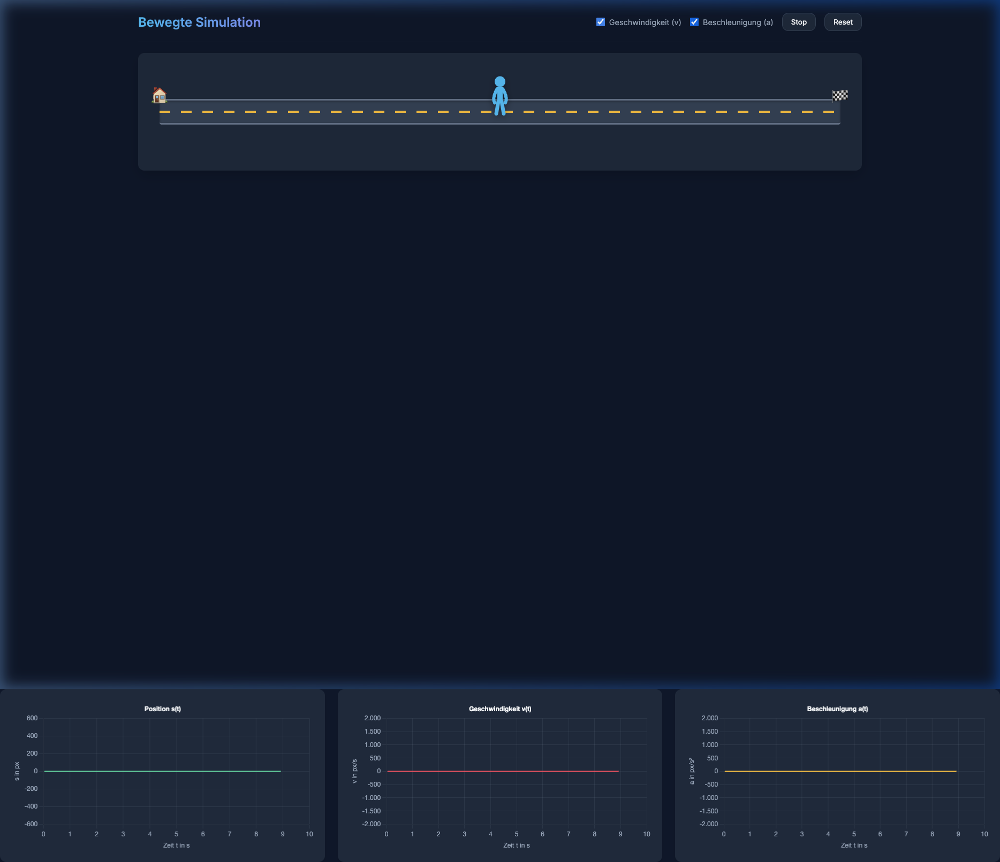

# Bewegte Simulation

Eine interaktive HTML5 Physik-Simulation zur Veranschaulichung von relativer Position, Geschwindigkeit und Beschleunigung.

Dieses Projekt wurde im Stil der bekannten **PhET Interactive Simulation "The Moving Man"** (Der bewegte Mann) nachempfunden. Es dient als moderne, web-native Alternative.



## Überblick & Features

- **Interaktiver "Bewegter Mann"**: Die Figur kann flüssig mit der Maus oder per Touch-Geste auf dem Smartphone über eine Rennstrecke (markiert durch Haus 🏠 und Ziel 🏁) gezogen werden.
- **Echtzeit-Diagramme**: Simultan zur Bewegung generiert die Engine ein $s-t$- (Position), ein $v-t$- (Geschwindigkeit) und ein $a-t$-Diagramm (Beschleunigung).
- **Integrierte Signalfrequenz-Glättung**: Um die mikroskopischen, fehlerhaften Ruckler menschlicher Mausführungen zu neutralisieren, glättet ein Moving-Average-Filter in Echtzeit rekursiv die Signale für die analytischen $v$- und $a$-Kurven. Ansonsten würden nur verrauschte Spikes angezeigt werden.
- **Start/Stop-Kontrolle**: Wie beim Vorbild lässt sich die Zeit der Simulation jederzeit anhalten (Pausen-Zustand).
- **Diagramm-Toggles**: Reduziere die kognitive Last durch Ausblenden komplexerer Ableitungsgraphen.

## Tech-Stack
Diese Simulation kommt komplett ohne massives Frontend-Framework aus:
- **Vanilla TypeScript** (Logik & Physik-Engine)
- **Vite** (Rasend schneller Dev-Server & Bundling)
- **Chart.js** (Hochperformantes HTML5-Canvas Rendering für die Achsen)
- **Vanilla CSS** (Vollständig responsives, modernes Dark-Theme)

## Lokale Entwicklung (Development)

Voraussetzungen: Du benötigst [Node.js](https://nodejs.org/) (Version `^20.19.0 || >=22.12.0`) auf deinem Rechner.

1. **Abhängigkeiten installieren:**
   In diesem Verzeichnis den Paketmanager starten:
   ```bash
   npm install
   ```

2. **Entwicklungsserver starten:**
   ```bash
   npm run dev
   ```
   Die Simulation läuft nun live unter `http://localhost:5173`. Sämtliche Änderungen an TypeScript-, HTML- oder CSS-Dokumenten werden in Millisekunden per Hot Module Replacement (HMR) in den Browser gepusht.

## Build Process (Produktion & Hosting)

Diese Applikation ist zu 100% statisch (Client-Side) und benötigt kein spezielles Backend. Um sie für einen Webserver fertig zu kompilieren:

1. **Statischen Build erzeugen:**
   ```bash
   npm run build
   ```
   *Vite baut die Applikation nun im `dist/`-Ordner zusammen. Das TypeScript wird extrem effizient kompiliert und minifiziert; Assets werden gehasht und gebündelt.*

2. **Hosting:**
   Du kannst den Inhalt des neu erstellten **`dist`**-Ordners nehmen und auf **jedem** beliebigen Webserver ablegen (z. B. GitHub Pages, Vercel, Netlify, Apache, Nginx oder einem simplen FTP-Laufwerk der eigenen Schule/Uni).

3. **Lokaler Test des Builds:**
   Möchtest du vorher lokal prüfen, ob das kompilierte Produkt (aus dem `dist/` Ordner) korrekt läuft:
   ```bash
   npm run preview
   ```
